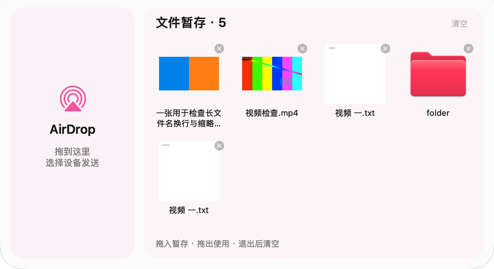

# AirDrop Drawer（顶部文件抽屉）

**把文件先放到屏幕顶部，切回目标窗口，再拖进去。**

  [](https://github.com/JASONWONG1124/AirDropDrawer/releases/latest)

桌面上有一个视频，想拖进剪辑软件或网页上传区，桌面却被一堆窗口挡住。为了拖一个文件，只好挪开窗口、缩小应用，再找出桌面上的素材。

**AirDrop Drawer 在屏幕顶部提供一个随时可展开的文件暂存区。先放入文件，再切换窗口取出，两个位置不必同时出现在屏幕上。** 左侧保留 AirDrop 入口，需要发送给附近设备时也可以直接拖入。

[下载 App](https://github.com/JASONWONG1124/AirDropDrawer/releases/latest) · [使用方法](#使用方法) · [文件会被复制吗](#文件会被复制吗) · [从源码构建](#从源码构建)



*由实际 AppKit 界面渲染，使用合成图片、视频和测试文档展示布局；玻璃材质会随桌面背景和系统外观变化。*

## 它能帮你做什么

- **跨窗口拖文件。** 从桌面或 Finder 拖入暂存区，切到目标应用后再取出，减少整理窗口的步骤。
- **看缩略图找文件。** 图片和视频显示内容预览，文件名在下方，多文件并排、自动换行，超出后可滚动。
- **同一个文件反复使用。** 拖出后继续保留，直到手动移除、清空或退出应用。
- **快速 AirDrop。** 把文件放到左侧区域，调用系统 AirDrop 界面选择设备发送。
- **随用随开。** 常驻菜单栏，不占 Dock；拖文件到顶部或空手在顶部停留，都能展开抽屉。

当前版本：**0.4.1**。支持一次放入多个文件，逐个拖出。

## 下载和安装

**只想使用，不需要下载源码，也不需要安装 Xcode。**

1. 打开 [最新版本下载页](https://github.com/JASONWONG1124/AirDropDrawer/releases/latest)。
2. 在 **Assets** 中下载 **`AirDrop-Drawer-0.4.1.zip`**。
3. 解压得到 `AirDrop Drawer.app`，拖入“应用程序”文件夹。
4. 双击打开，顶部菜单栏出现 AirDrop 抽屉图标。

分享给朋友时，可以直接发这个 ZIP，也可以发送上面的下载页。GitHub 自动提供的 **Source code (zip)** 是源码，不是可直接打开的 App。

### 首次打开被 macOS 阻止时

当前版本使用本地临时签名，尚未经过 Apple Developer ID 签名和公证。确认文件来自本仓库发布页后，如果系统提示无法验证开发者，可按 [Apple 官方说明](https://support.apple.com/zh-cn/102445)，在尝试打开后进入“系统设置 → 隐私与安全性”，查看该 App 对应的“仍要打开”选项。

### 兼容性

| 项目 | 要求 |
| --- | --- |
| 芯片 | Apple Silicon，M 系列 |
| 系统 | macOS 26 或以上 |
| 当前安装包 | arm64，不支持 Intel Mac、Windows 或手机 |
| 文件来源 | 已下载到本机的普通文件、文件夹及文件包 |
| 目标应用 | 需要支持相应文件类型的拖放导入 |

当前版本在 macOS 27 上完成开发和用户验收，最低部署版本为 macOS 26；不同系统版本、显示器和目标应用的实测情况见 [验证记录](docs/VALIDATION.md)。

## 使用方法

### 暂存文件，再拖入目标应用

1. 从桌面或 Finder 按住文件，拖到**屏幕顶部中央**。
2. 抽屉展开后，把文件放进右侧“文件暂存”区域。
3. 松开鼠标，切换到需要接收文件的窗口，例如剪辑软件或网页上传区。
4. **不需要再拿着文件**：将鼠标移到屏幕顶部中央，停留约 0.35 秒。
5. 抽屉展开后，按住文件缩略图或文件名，拖到目标区域。

拖出时抽屉会隐藏，让出下方的目标窗口。文件是否被接收以及导入后的行为，由目标应用决定。

### 通过 AirDrop 发送

把文件拖到顶部，放进左侧 **AirDrop** 区域，在系统弹出的分享界面中选择设备。

### 管理暂存内容

| 操作 | 结果 |
| --- | --- |
| 点击文件右上角 × | 只移除该暂存条目，原文件保留 |
| 点击“清空” | 清空暂存条目，5 秒内可以撤销 |
| 从暂存区拖出 | 文件条目继续保留，可重复使用 |
| 重复放入同一文件 | 不重复添加 |
| 退出或重启 App | 清空本次暂存引用，下次从空列表开始 |

菜单栏还提供“打开暂存区”“暂停自动展开与接收”和“登录时启动”。暂停后仍可通过菜单打开暂存区并拖出已有文件。

## 文件会被复制吗？

**放入暂存区时，App 记录原文件的引用，不另外复制一份视频，也不把原文件移走。**

因此，大文件无需等内容复制完成。移除和清空只删除暂存条目，不会删除桌面或 Finder 中的原文件。图片和视频会异步生成小尺寸预览用于显示。

- 原文件改名或移动后，App 会尝试通过文件书签追踪；无法找到时提示重新拖入。
- 原文件被删除、所在磁盘断开或失去读取权限后，暂存条目无法继续使用。
- 暂存区不提供备份。退出后不会恢复上一次的文件列表。
- 拖向其他应用时提供标准文件 URL，并只允许复制操作；目标应用可能读取、复制或导入该文件。

## 常见问题

**顶部没有展开怎么办？** 先确认 App 正在运行、没有暂停，将鼠标放在顶部中央而非角落停留；也可以点菜单栏“打开暂存区”。如果触发了调度中心或其他系统动作，请检查自己的触发角及手势设置，App 不会代你修改系统设置。

**文件为什么没有内容缩略图？** 系统不支持预览的格式会显示原生文件图标，仍可拖出。部分文件需要短暂等待预览生成。

**能把文件拖进任何应用吗？** 目标区域需要支持文件拖放，而且接受该文件格式。暂存区不会改变目标应用本身的导入规则。

**支持粘贴文字或网页链接吗？** 当前只接收本地文件。文字、网页链接、尚未下载的云文件以及没有实际文件的拖放内容不在当前支持范围内。

## 隐私与文件访问

- 无账号系统、广告、分析 SDK 或遥测。
- 暂存列表只保存在本次运行的内存中，不上传到服务器。
- 缩略图由 macOS Quick Look 生成，App 只在内存中缓存结果；系统自身可能管理预览缓存。
- 文件访问由拖入操作发起；macOS 可能对桌面、文稿或下载目录提示访问权限。
- 只有你选择左侧 AirDrop 时，才调用系统服务发起分享。

## 从源码构建

<details>
<summary>开发者展开查看构建、检查和打包步骤</summary>

项目使用 Swift 和 AppKit，不依赖第三方库。当前验证工具链为 **Swift 6.4、macOS SDK 27.0、Xcode Command Line Tools**；最低运行系统设置为 macOS 26。

```bash
git clone https://github.com/JASONWONG1124/AirDropDrawer.git
cd AirDropDrawer

# 核心逻辑检查
swift run --build-system native --scratch-path .build-v0.4 DrawerCoreChecks

# AppKit、文件引用、缩略图等原生检查，需要可用的 macOS 图形会话
zsh scripts/check-native.sh

# 编译、组装 .app 并进行本地临时签名
zsh scripts/build.sh
```

构建结果：`dist/AirDrop Drawer.app`。脚本只生成构建产物，不自动覆盖已安装的 App。

需要自行压缩分享时：

```bash
ditto -c -k --sequesterRsrc --keepParent \
  'dist/AirDrop Drawer.app' 'dist/AirDrop-Drawer-0.4.1.zip'
```

当前脚本显式指定 SDK 并使用 SwiftPM native 构建引擎；工具链会提示该引擎未来弃用。更换构建方式后，需要重新确认 SDK 标记及实际运行效果。

</details>

## 项目结构

```text
Sources/AirDropDrawer/       原生抽屉、菜单栏、文件暂存、AirDrop 与拖放
Sources/DrawerCore/          鼠标意图与本地文件校验
Tests/DrawerCoreTests/       核心逻辑检查
Resources/AppIcon.icns      应用图标
scripts/build.sh            构建并签名 App
scripts/check-native.sh     运行原生检查
assets/                    README 界面预览
docs/VALIDATION.md         验证结果与范围
CHANGELOG.md               更新记录
```

问题反馈请提交 [Issue](https://github.com/JASONWONG1124/AirDropDrawer/issues)，附上 macOS 版本、芯片型号、文件类型、目标应用和复现步骤。更新内容见 [CHANGELOG](CHANGELOG.md)。
